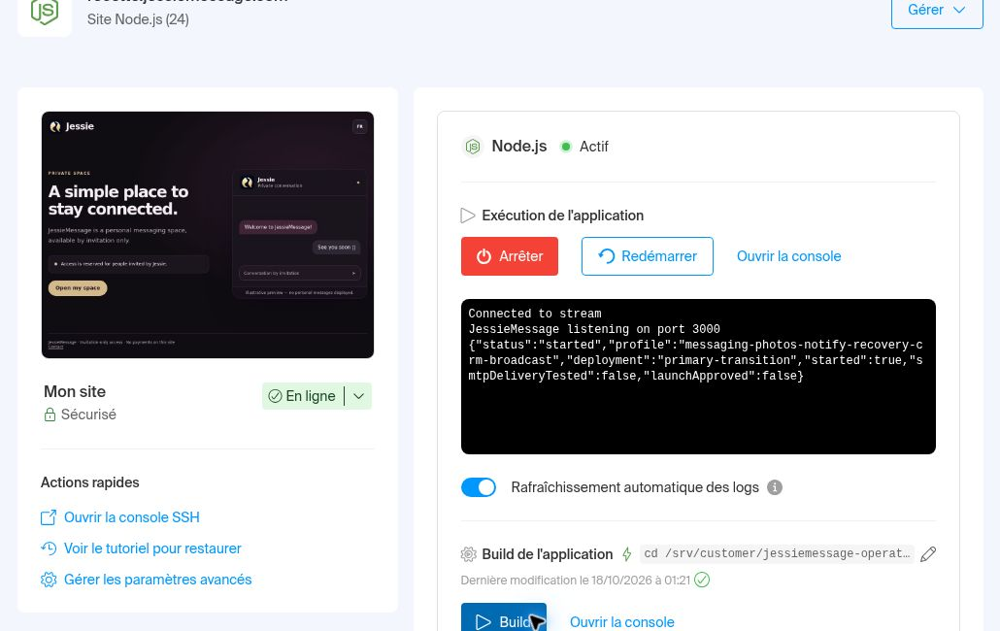

# JessieMessage — correction des messages individuels activée, étape 0.50

**Livré le 18 octobre 2026 à 01:21 Europe/Paris.** Les destinataires n’ont plus d’accord de diffusion à enregistrer et ne voient plus ce réglage. Chaque message reçu reste un message ordinaire dans sa conversation privée avec Jessie, sans titre de campagne, audience ni indication d’envoi groupé. La confirmation de Jessie dans son outil d’administration reste explicite.

## Version réellement exécutée

- Source : **`0a1cafd85c3d8699be1961075b18e80e36bcd041`**.
- Arbre : **`17db89aa165e23ca427d073f5a3fcc28387f5168`**.
- Checkout : **`/srv/customer/jessiemessage-operator/broadcast-direct-delivery-0a1cafd8`**, propre et figé sur cette source.
- Node : **24.15.0**, port **3000**.
- Profil : **`messaging-photos-notify-recovery-crm-broadcast`**, déploiement **`primary-transition`**.
- Configuration privée existante : **`/srv/customer/jessiemessage-private/primary-origin-candidate-4a355851`**.

Le dossier séparé est préparé avec les dépendances verrouillées (`npm ci --ignore-scripts`) et les vérifications de syntaxe. À **01:19:57.163475**, le préflight hébergé renvoie `checks_passed`, le profil complet, `primary-transition` et `started: false`. Il n’écrit aucune configuration, n’applique aucune migration et ne démarre pas de second serveur.

La coupure initiale de l’environnement est résolue avant cette préparation. Le Manager enregistre les deux commandes suivantes, puis lance un Build sans réinstaller les dépendances déjà préparées. Le Build réussit et déclenche le redémarrage : la console confirme l’écoute sur le port 3000 et le reçu `started` du profil complet. L’état final est **Node.js Actif**, avec « Dernière modification le 18/10/2026 à 01:21 ».

Run :

```bash
bash -c 'set -euo pipefail; cd /srv/customer/jessiemessage-operator/broadcast-direct-delivery-0a1cafd8; test "$(git rev-parse HEAD)" = 0a1cafd85c3d8699be1961075b18e80e36bcd041; test "$(git rev-parse HEAD^{tree})" = 17db89aa165e23ca427d073f5a3fcc28387f5168; test -z "$(git status --porcelain)"; exec env -u NODE_OPTIONS -u NODE_PATH JESSIEMESSAGE_PRIVATE_PATH_MODE=linux-dirfd PORT=3000 node scripts/start-private-messaging.mjs start --deployment primary-transition --profile photos-notify-recovery-crm-broadcast --private-directory /srv/customer/jessiemessage-private/primary-origin-candidate-4a355851 --private-path-mode linux-dirfd'
```

Build :

```bash
cd /srv/customer/jessiemessage-operator/broadcast-direct-delivery-0a1cafd8 && test "$(git rev-parse HEAD)" = 0a1cafd85c3d8699be1961075b18e80e36bcd041 && test "$(git rev-parse HEAD^{tree})" = 17db89aa165e23ca427d073f5a3fcc28387f5168 && test -z "$(git status --porcelain)" && npm run check
```

## Contrôles après redémarrage

À **01:22:38.231618 Europe/Paris**, **69/69 contrôles HTTPS** passent. Le vérificateur impose la source, l’arbre et le checkout propre, utilise la validation TLS normale, ne suit pas automatiquement les redirections et n’envoie ni cookie ni POST.

| Contrôle | Lectures conformes |
| --- | ---: |
| Huit ressources publiques comparées octet pour octet au moyen de leur SHA-256 sur chaque origine | 16 |
| Santé `ok` et disponibilité `ready`, HTTP 200 sur chaque origine | 4 |
| Fichiers et API CRM protégés, HTTP 401 sans session | 12 |
| Page, fichiers et API de diffusion d’administration protégés, HTTP 401 sans session | 14 |
| Diagnostic d’administration protégé, HTTP 401 sans session | 10 |
| Module et anciennes routes de diffusion client retirés, HTTP 404 en lecture | 6 |
| Chemins de configuration/source internes non servis | 4 |
| Récupération : HTTP 200 sur l’origine principale, 404 sur la recette conservée | 2 |
| Redirection HTTPS de `www` vers l’origine principale | 1 |

Les réponses applicatives vérifiées portent `no-store`. Les seize comparaisons exactes portent sur `/access`, les scripts/styles d’accès, les scripts/styles/modèle de conversation et les catalogues de traduction des outils et de la conversation. Les deux origines sont `https://jessiemessage.com` et `https://recette.jessiemessage.com`.

La capture ci-dessous montre le reçu de démarrage, l’état Actif et le Build réussi. Elle ne contient aucun compte invité ni conversation privée.



Capture JPEG : 67 425 octets ; SHA-256 **`1302db93e906f3ba5a57fdfb11b1db465e49339edc575777e8bf7d850c455895`**.

## Tests et limites des preuves

Les [cinq jobs de CI de la source exécutée](https://github.com/fredbuhr/jessiemessage/actions/runs/39078063012) sont réussis : 2 268 tests généraux réussis sur 2 295 (27 wrappers SQL ignorés), build réussi, **383/383 sur chaque MariaDB**, **101/101 Chrome** et **1/1 authentification HTTPS**. Les nouveaux scénarios vérifient l’envoi sans préférence, avec une ancienne préférence désactivée et après modification d’une préférence historique pendant le traitement. Révocation, expiration, annulation, déduplication et isolation des messages restent couvertes.

Ces essais sont synthétiques. Les GET hébergés ne prouvent pas la réception dans les appareils personnels : **aucune campagne réelle de test n’est créée ou envoyée par l’agent**, et aucun nouvel essai personnel n’est déclaré accepté. Les acceptations précédentes de messagerie, photos, notifications, récupération, coffre, restauration isolée et parcours essayé des fiches restent acquises, sans extension à des parcours non essayés.

Schéma 30, six fichiers de configuration, clés, comptes et règles de sessions restent inchangés. Les valeurs de `broadcast_preferences` sont conservées comme historique et ne conditionnent plus les envois. Les destinataires déjà terminés ne sont pas remis en file. Les sauvegardes de campagnes conservent les formats 9/10 et reçus 7/8.

La limite reste **100 destinataires par campagne**. Une audience de 1 000 dans une seule campagne n’est pas annoncée comme disponible. Les sauvegardes récurrentes avec copie indépendante et la surveillance/alerte restent des travaux d’exploitation à terminer.

## Utilisation et repli

Actualiser la page, ouvrir **Messages → Diffusions**, choisir les destinataires ayant accès, préparer le message et confirmer. Le destinataire n’a aucun accord de diffusion à donner.

Le [guide d’activation et de repli](deploy-broadcast-individual-050.md) conserve les commandes. Le repli direct est la version 0.49 `d77f16fb`, arbre `5897917c`, avec son lanceur existant et son Build figé. Il réintroduit l’ancien accord invité ; il ne supprime pas les campagnes, ne restaure pas de SQL et ne révoque pas les sessions. Une campagne encore approuvée et en attente peut reprendre selon ses droits et son échéance ; utiliser l’annulation explicite pour arrêter ses envois restants.
