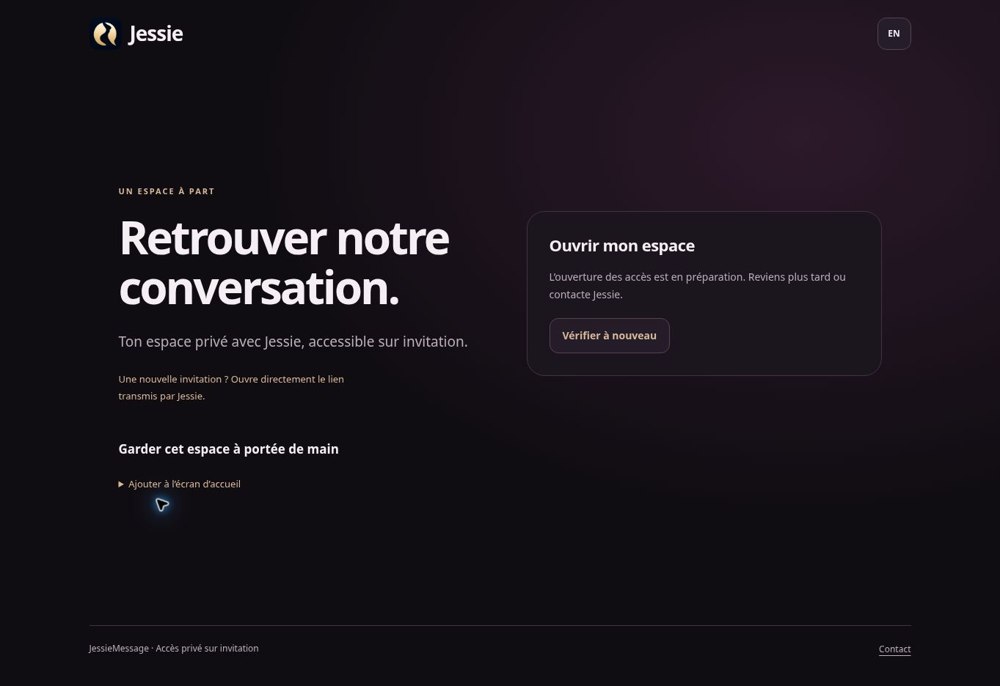

# Préparation SQL hébergée — étape 0.25

Relevé du **15 octobre 2026**. Application **0.24.0**, révision exécutée **`55fb30aa191fb75f898e5818324c4ec35341ac74`**. Ce suivi prolonge le [premier démarrage neutre et sa contre-vérification](first-hosted-start.md). Le lot documentaire ne change pas le serveur exécuté.

## État constaté

| Élément | Résultat |
| --- | --- |
| HTTP neutre | Sept GET HTTPS conformes depuis l’hébergement à **15:26:39 UTC**, puis mêmes réponses à **15:39:51 UTC** après création de la base ; accueil et entrée également rendus dans Chrome |
| Processus | Manager actualisé : Node actif ; aucune relance, modification de Start ou opération de repli pendant cette reprise |
| Base de recette | Nouvelle base dédiée créée dans le contrat existant ; le Manager indique **0 octet**, sans site lié ni permission attribuée |
| Moteur | Manager : **MariaDB 10.11.19**, port **3306** |
| Utilisateurs SQL | Page Utilisateurs : **aucun utilisateur** après la création de la base |
| TLS sans authentification | **15:33:16 UTC**, handshake OpenSSL terminé avec code **0**, **TLS 1.3**, `TLS_AES_256_GCM_SHA384`, `Verification: OK` et contrôle du nom réussi |
| Application privée | Huit drapeaux à `0` ; aucune connexion applicative SQL, migration, clé MFA, initialisation administrateur ou configuration SMTP effectuée |

La base a été créée sans utilisateur associé, après vérification du récapitulatif des permissions vide. Le nom complet, le préfixe du compte, le hostname, les identifiants Manager et les chemins privés ne sont pas publiés. Les ressources ZTIKIX ne sont pas modifiées. Le dossier du modèle initial reste disponible pour repli du site neutre.

Le formulaire d’un compte **de migration** est préparé avec un nom non secret ; son champ mot de passe reste vide et sa création n’est pas validée. Ce formulaire ne constitue pas un compte existant.

## Portée du test TLS

La commande utilise le hostname exact et le port relevés dans le Manager, depuis la console SSH de l’hébergement. Elle est bornée à douze secondes, avec arrêt forcé éventuel deux secondes plus tard. L’entrée standard est vide ; aucun nom d’utilisateur, mot de passe ni SQL n’est envoyé.

Exemple avec une variable privée déjà renseignée, sans hostname réel :

```sh
timeout --signal=TERM --kill-after=2s 12s \
  openssl s_client -starttls mysql \
  -connect "${JM_TLS_DB_HOST}:3306" \
  -servername "$JM_TLS_DB_HOST" \
  -verify_hostname "$JM_TLS_DB_HOST" \
  -verify_return_error -min_protocol TLSv1.2 \
  -brief -no_ign_eof </dev/null
```

La [documentation OpenSSL](https://docs.openssl.org/3.0/man1/openssl-s_client/) distingue la vérification bloquante du certificat, le contrôle du nom et le mode `mysql` de STARTTLS. Le magasin de confiance système est utilisé. Le test observé n’a ni désactivé la vérification ni ajouté de CA privée.

Ce résultat établit une négociation TLS vérifiée sur cet endpoint à cet instant. Il ne prouve pas encore la connexion du connecteur Node `mariadb`, ses autorités de confiance, l’identité de la base sélectionnée, les droits SQL, `GET_LOCK`, les contraintes physiques ou les migrations. Les diagnostics applicatifs réels restent à exécuter avec des identifiants fournis par un canal privé.

## Droits : écart à résoudre avant le runtime

La [FAQ officielle de gestion SQL](https://www.infomaniak.com/fr/support/faq/1981/gerer-les-utilisateurs-et-bases-de-donnees-mysqlmariadb), consultée le 15 octobre, décrit trois groupes de droits : lecture, écriture et administration. Le groupe écriture inclut `CREATE TEMPORARY TABLES` et `LOCK TABLES`, en plus des mutations de données. La [FAQ des opérations permises](https://www.infomaniak.com/fr/support/faq/2588/comprendre-les-actions-mysql-possibles) confirme cette distinction entre les offres mutualisée et Cloud.

Le diagnostic actuel de `server/preflight/database.mjs` n’accepte que `USAGE`, `SELECT`, `INSERT`, `UPDATE` et `DELETE`. Un grant contenant ces deux droits supplémentaires échouera donc au contrôle `privileges`. Le code applicatif relu n’a pas besoin de tables temporaires ni de verrous `LOCK TABLES` ; les transactions, verrous de lignes et `GET_LOCK` ne sont pas ce droit.

Il s’agit d’une incompatibilité **prévisible du profil documenté**, pas d’un `SHOW GRANTS` obtenu sur cet hébergement : aucun compte n’existe encore. La possibilité de droits personnalisés ou par table n’est pas établie. Le compte runtime doit également conserver seulement `SELECT` sur `schema_migrations`, conformément à [la séparation des comptes](auth-admin.md). Un profil lecture/écriture appliqué à toute la base ne fournit pas à lui seul cette séparation. Aucun garde-fou n’est assoupli dans ce lot.

## Reprise concrète

1. Créer le compte de migration, réservé à cette seule base de recette, avec les droits de lecture, écriture et DDL nécessaires au migrateur. Conserver le mot de passe dans un support privé ; ne pas le transmettre au chat, au dépôt, à l’historique shell ou à une capture. La base existe déjà : laisser désactivée l’option de création d’une autre base associée.
2. Fournir sa configuration privée au processus opérateur, confirmer exactement la base puis établir la connexion avec le connecteur Node, son certificat et le moteur réel. Commencer par le `status` non destructif du [migrateur](DATABASE.md), et contrôler l’isolation, les droits et `GET_LOCK` avant toute application du schéma.
3. Déterminer comment obtenir le compte runtime distinct avec les droits requis, dont le registre en lecture seule. Constater ses grants réels. Si les profils du Manager ne suffisent pas, obtenir une solution de droits fins de l’hébergeur ou revoir explicitement la stratégie ; ne pas accepter automatiquement des permissions supplémentaires.
4. Appliquer les migrations immuables seulement après ces vérifications. Le Manager affiche 0 octet ; l’absence d’objets sera confirmée par le statut SQL. Aucun des vingt-sept fichiers de migration n’a été exécuté sur l’hébergement.
5. Confirmer l’environnement de recette avant une activation d’authentification. Le quota Node est toujours **1/1** et l’alias temporaire dessert le même processus. Il ne constitue pas un environnement indépendant. Le préflight actuel reste limité à un sous-domaine officiel distinct de l’apex ; cette préparation SQL ne modifie pas cette règle.
6. Préparer les clés, leur sauvegarde privée, le bootstrap administrateur et la recette HTTPS conformément aux [prérequis d’authentification](auth-admin.md) et à la [recette](preproduction-acceptance.md). Les services privés restent désactivés jusque-là.

## Preuve publique de la contre-vérification

L’entrée `/app` rend l’état français « accès en préparation » après la réponse neutre de `/api/entry`. La capture suivante concerne uniquement cette page publique et ne contient aucune information du Manager :



**contact@jessiemessage.com** reste l’adresse officielle. Aucun résultat de ce document ne vaut recette de charge, restauration ou ouverture du pilote privé.
